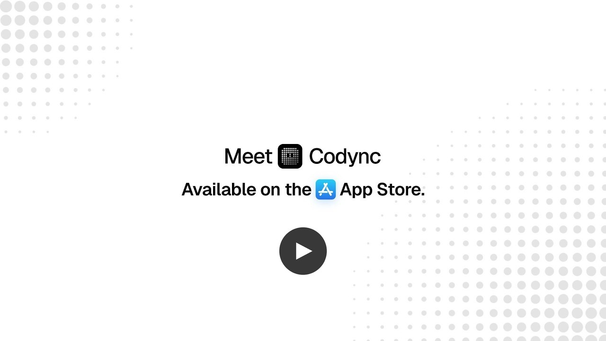
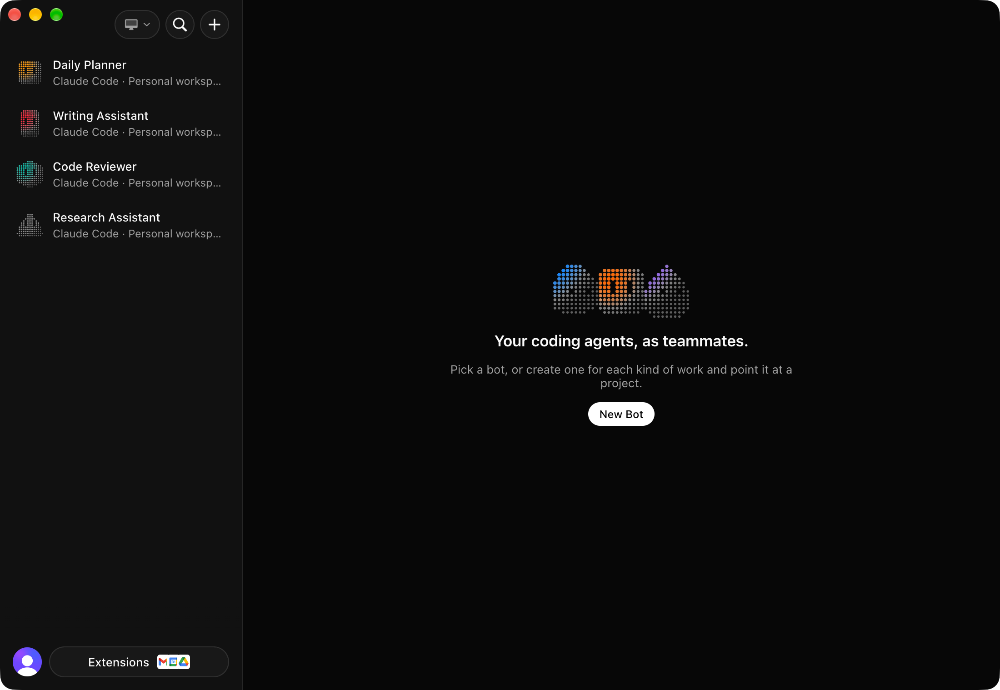

<div align="center">


# Codync

**The open-source Grok Bot alternative.**<br>
Your coding agents, as teammates you can message.

> **Fork note** — this is [Ali120B](https://github.com/Ali120B)'s fork of [Codync](https://github.com/leepokai/Codync).
> Builds, releases and app updates come from [Ali120B/codyncRe](https://github.com/Ali120B/codyncRe/releases);
> the Android phone app, optional account sign-in and the wired-in cloud relay are upstream's for now.

[Website](https://www.codync.dev) · [Compare](https://www.codync.dev/compare) · [Launch film](https://youtu.be/QAhyZWpV70U)

[](https://github.com/Ali120B/codyncRe/stargazers)<br>
<sub>Free, open source, no paid tier. A ⭐ is how others find it.</sub>

[](https://github.com/Ali120B/codyncRe/releases/latest/download/codync-windows-x64.exe)
[](https://github.com/Ali120B/codyncRe/releases/latest/download/codync-linux-x86_64.AppImage)
[](https://github.com/Ali120B/codyncRe/releases/latest/download/codync-linux-arm64.AppImage)

Windows: x64 installer · Linux: AppImage (x86_64 + arm64) — [all downloads](https://github.com/Ali120B/codyncRe/releases/latest)

[](https://github.com/Ali120B/codyncRe/releases/latest)
[](LICENSE)
<br>


<a href="https://youtu.be/QAhyZWpV70U"></a>




</div>

Codync turns the coding agents on your computer — Claude Code, Codex, Cursor, Pi, OpenCode, Grok Build, Gemini, Copilot and ~40 more — into persistent *bots* you delegate to from your Android phone, Linux, Windows PC, Linux desktop or any terminal, the way you'd message a colleague. Pick who, say what, put the phone away. You get a notification when a bot finishes or needs your approval.

> Why bots? On a phone, "find the right working session, then pick an environment" is too slow. With bots you already know who to hand the intent to: open the chat, type, done.

## Why Codync

- **Free and open source.** No subscription, no paid tier, Apache 2.0 licensed. It runs on your computer with the agents and accounts you already have.
- **Bring any coding agent.** Claude Code, Codex, Cursor, Gemini, Copilot, OpenCode, Pi, Grok Build and ~40 more — everything in the [ACP registry](https://agentclientprotocol.com/registry). Installed agents are found automatically, the rest are fetched on first use, and every bot picks its own. Mix them freely: a Claude bot can ask a Codex bot for a review.
- **Many bots, one team.** Run as many bots as you like side by side, each with its own agent, project folder and approvals, all working at once. Put 2–50 in a **group room** and they answer in turn, like a team channel; `@name` picks who replies. Type `@all` alone for a merged standup of every member's status and blocker, with owners. When one bot @mentions another, it automatically hands off what it tried, what changed and the next step. Each member can get its own Browser or Computer access inside the room without changing its own setup, group Files show who wrote what, and group routines run with the room's context. Start a **thread** on any message to branch off without cluttering the main chat.
- **Undo a bad run.** Every turn snapshots the project folder and the chat before the agent starts. Open a message's menu and **Rewind to before this message** to restore the files and remove that turn and everything after it, in a direct chat or a group room.
- **One place for what needs you.** The inbox above your account footer collects permission cards, failed sends, sign-ins, device approvals and bots whose last run failed. Click one to jump straight to it.
- **⌘K for everything.** The command deck searches bots and runs app-wide actions: new chat, create a bot or group, Extensions, Settings, Computers, Usage, Team map, Account and approval review.
- **Routines that fit the work.** Run a bot once, every few minutes, hourly, daily, on weekdays or a chosen day each week or month — or from a webhook. Set the time with a real time picker, choose the time zone, and see the next run before saving.
- **Apps and skills when you need them.** Connect Gmail, Slack, GitHub, Notion and 1,000+ apps through Composio, or give bots reusable skills; the Marketplace leads with popular apps and expands only when you ask.
- **Built in Rust.** `codync-host` is one small, fast Rust binary for Windows and Linux (static on Linux, runs on any distro) that drives every agent, keeps the transcripts and serves every client.
- **One app per kind of device.** Native Kotlin (Jetpack Compose) on Android, one desktop app for Linux and Windows (Electron), and a terminal UI for SSH.
- **A Grok Bot, Muse and Dots alternative.** Persistent named bots, group chats, reply threads, bots asking each other for help, approval cards, per-bot memory, remote screen, voice calls and "needs you / done" notifications — the same features, without being tied to one model or one subscription.
- **Reach your computer from anywhere, free.** The hosted Cloudflare relay is included at no cost: no Tailscale, no VPN, no port forwarding. Traffic is end-to-end encrypted between your phone and your computer, so the relay only forwards ciphertext. Same Wi-Fi or Tailscale? The phone connects directly instead.
- **Every computer, one app.** Your Android phone lists every computer you've paired — or signed in to, where account support is configured. Tap **Connect**, confirm a 6-digit code on that computer, and its bots show up next to the others. A new bot can live on any of them, and the Linux app reaches your SSH machines too. Each computer approves each device itself, so an account alone never unlocks a computer.
- **Remote screen.** See and control your computer from the Android phone over WebRTC (hardware H.264), and let bots use the screen themselves through the built-in `computer` tool.
- **Voice calls.** Talk to a bot hands-free from the Android phone and hear its replies read aloud.
- **Private push.** Notification text is sealed to your phone's key, so the push relay never sees what your bots said.

## Platforms

| | Platform | App | Highlights |
|---|---|---|---|
| 🤖 | **Android** | Native Kotlin (Jetpack Compose) | Chat with bots, approvals, push notifications, computer panel, files, workspaces sync |
| 🪟 | **Windows** | Desktop app (Electron), tray + window | Runs the host, chat window, Android phone pairing (no remote screen yet) |
| 🐧 | **Linux** | Desktop app (Electron), tray + window | Chat window, Android phone pairing; the host runs on desktops and headless servers |
| ⌨️ | **Terminal** | `codync-host tui` | Message your bots from any terminal, over SSH too |

The host (`codync-host`, Rust) runs on Windows and Linux; every client talks to it, so all your bots and chats are the same everywhere.

**Looking for the former native Linux app (SwiftUI + AppKit)?** Version 2.7.0 moved Linux and
Linux to one Electron desktop app. The native implementation is preserved in Git history;
see the [changelog and source lookup commands](#changelog) and the
[archived AppKit chat implementation notes](docs/archive/macos-chat-swiftui.md).

## How it works

```text
Android client ⇄ encrypted channel (direct or Cloudflare cloud/) ⇄ codync-host ⇄ ACP agent
Local / SSH client  ⇄ loopback HTTP + SSE                             ⇄ codync-host
Host notifications → push relay (relay/) → Android phone
```

- **Bots** have a name, a character avatar, standing instructions, an agent backend, a project folder and a permission policy. Each bot has **a persistent main chat and optional reply threads**; the agent sessions underneath are an implementation detail (resumed with `session/load`, restarted with *New session*).
- **Group rooms** hold 2–50 bots and you. Each message starts a short room turn: the bots you @-mention (or everyone) reply one at a time, each in its own session, and can react to each other, up to 3 rounds. Browser and Computer switches are scoped to the room and never rewrite a bot's own setup; group routines and attributed Files live alongside the chat. See [group chats and threads](docs/features/groups-and-threads.md).
- **Bots can ask each other for help.** Tell one “ask Reviewer to check these changes.” The built-in `team` MCP server lets it discover your other visible bots and wait for a reply. Requests appear in both chats; each recipient keeps its own agent, folder and approvals. Native subagents stay under the coding agent's control. See [bot collaboration](docs/features/bot-collaboration.md).
- **The chat only shows what matters**: your messages, each turn's final reply, approval cards and notices. Every tool call, diff, plan and thought is one tap away in *Full conversation*. While a bot works, its row shows what it's doing right now.
- **Agents are detected automatically**: the host hydrates PATH from your login shell (plus Homebrew, ~/.local/bin, nvm, bun, volta, asdf, mise, pnpm…), finds every harness you have installed, and prefers its native ACP mode. Anything else in the official [ACP registry](https://agentclientprotocol.com/registry) can be picked too — Codync fetches it on first use (npx, uvx or a checksummed binary).
- **codync-host** (Rust, Windows and Linux) runs on your computer. It speaks the [Agent Client Protocol](https://agentclientprotocol.com) to each agent, keeps transcripts in SQLite, and serves the phone. Every change carries a global `rev`, so the phone reconnects with `since: rev` and never misses anything.
- **Usage limits** come from your local installs, with no extra login: Claude via `claude -p /usage` (a local command, no model call) plus Claude Code's status line, Codex via `~/.codex/sessions`. The phone, widgets and menu bar only see percentages.
- **Push** goes through a tiny relay that holds the FCM credentials. The phone trades its device token for an encrypted ticket; the host only ever holds tickets.

UI patterns (roster, character avatars, approval cards, trace sheet, "needs you / done" notifications) follow Grok Bot.

## Install

**One line** (Linux — the host, plus the desktop app when a display is present):

```bash
curl -fsSL https://raw.githubusercontent.com/Ali120B/codyncRe/main/packaging/install.sh | sh
```

Add `sh -s -- --host-only` for servers and headless machines. Re-run it to upgrade; it downloads this fork's [Releases](https://github.com/Ali120B/codyncRe/releases/latest).

**Windows** — [download codync-windows-x64.exe](https://github.com/Ali120B/codyncRe/releases/latest/download/codync-windows-x64.exe) and run it. It installs for your user and starts the host at sign-in. The installer isn't code-signed yet, so SmartScreen asks you to confirm it once (**More info → Run anyway**). Not on Windows yet: remote screen, on-device speech and the Claude Code status line hook. Details: [desktop app](docs/architecture/desktop-app.md#platform-notes).


**Linux** — the host, plus the desktop app:

```bash
curl -fsSL https://raw.githubusercontent.com/Ali120B/codyncRe/main/packaging/install.sh | sh
codync-host install   # systemd --user service
codync-host pair      # QR code in the terminal, or Settings in the app
```

The script also installs the desktop app (`codync`, an AppImage, with its `.desktop` file) when you're in a graphical session. By hand: `codync-linux-<arch>.AppImage`, `.deb` or `.tar.gz` from [Releases](https://github.com/Ali120B/codyncRe/releases/latest) (x86_64 and arm64).

**Any platform, from source** — the host is plain Rust, the desktop app is Electron:

```bash
cd host && cargo build --release && ./target/release/codync-host install
cd apps/desktop && npm ci && npm run dev
```

**Linux server / cloud VM** — the host runs headless on any distro (static binary, x86_64 + arm64). Setup, remote access and limitations: [docs/guides/linux-servers.md](docs/guides/linux-servers.md).

**Remote access** works out of the box through the Cloudflare relay, end-to-end encrypted; the phone switches to a direct connection on the same network or over Tailscale. Details: [remote relay](docs/reference/remote-relay.md).

**Agents** — install and sign in to whichever you use; Codync finds them. Claude Code, Codex and Pi run through their ACP adapters (fetched by `npx`, so Node.js is needed for those).

`codync-host install` also routes Claude Code's status line through `codync-host statusline` so live limits reach the host; an existing status line keeps working (it's wrapped, and restored on `uninstall`).

## `codync-host`

| Command | |
|---|---|
| `codync-host install` / `uninstall` | background service (systemd `--user` on Linux, the sign-in Run key on Windows) |
| `codync-host tui [--url … --token …]` | message your bots from a terminal (this computer by default; SSH-friendly) |
| `codync-host pair [--json]` | pairing QR code / link |
| `codync-host status` | installed? running? |
| `codync-host serve [--port 19222]` | run in the foreground |
| `codync-host statusline [-- <your command>]` | Claude Code status line command (wraps yours) |
| `codync-host reset-token` | rotate the local loopback bearer token |
| `codync-host cloud` | cloud enablement, URL and status |
| `codync-host devices` | list/revoke authorized remote devices |
| `codync-host access` | review device access requests |

Data lives in `~/.codync`. The local bearer token authorizes loopback helpers and SSH-forwarded callers. Remote devices use individual keys and grants over the encrypted channel; revoke a lost device through device management rather than rotating the loopback token. Host methods and caller permissions live in `host/src/api/`.

## FAQ

**Is Codync free?** Yes. $0 with every feature included, Apache 2.0 licensed. You pay only your agent's provider, through the plan or key you already have.

**Can I use my Claude or ChatGPT plan?** Yes. Codync runs the agents already signed in on your computer: Claude Code with your Claude plan, Codex with your ChatGPT plan, and so on. It never calls a provider's API with your login.

**Is there a Claude Code or Codex app for Android phone?** Codync is one, free: Claude Code or Codex keeps running on your Linux or Linux machine, and you chat with it, approve its edits and get notified from the Android phone. Guides: [Claude Code on Android phone](https://www.codync.dev/claude-code-iphone) · [Codex on Android phone](https://www.codync.dev/codex-iphone).

**Which agents can it run?** Claude Code, Codex, Cursor, Gemini, Copilot, OpenCode and about 40 more through the [ACP registry](https://agentclientprotocol.com/registry). Each bot picks its own.

**How is it different from Grok Bot, Muse or Dots?** The same bot-based way of working (named bots, group chats, threads, approvals, memory), but open source, free, running on your own computer and with any coding agent. Side-by-side pages: [codync.dev/compare](https://www.codync.dev/compare).

**Where does my data go?** Bots, chats and memory stay on your computer. The phone reaches it directly on the same network, or through an end-to-end encrypted relay that can't read your messages.

**Do I need an account?** No. Pair your phone by scanning a QR code. Signing in with Apple or Google is optional; local pairing never needs it.

**Which computers can run it?** A Linux, a Windows PC, or a Linux desktop or headless server. The Android phone app and the terminal UI over SSH talk to the same host.

## Versioning

Clients and the host each name the oldest version of the other they still work with (`minApp` in the host's `hello`, `minHost` in each client), so an app can meet an older or newer host. Details: [compatibility](docs/reference/compatibility.md).

## Contact

- Email: [kevin@codync.dev](mailto:kevin@codync.dev)
- Questions and bug reports: [GitHub Issues](https://github.com/Ali120B/codyncRe/issues)
- Security issues: report privately as described in [SECURITY.md](SECURITY.md) (GitHub private reporting or email)
- Community rules: [Code of Conduct](CODE_OF_CONDUCT.md)

## Credits

The desktop notch island's design is inspired by the work of [@novra.design](https://www.instagram.com/novra.design/).

## License

Apache 2.0 for the code (see [NOTICE](NOTICE)); versions up to 2.11.0 were MIT. The Codync name, logo and the Codync Cloud relay are not covered, and hosted or multi-tenant services must run their own relay and accounts: see [TRADEMARK.md](TRADEMARK.md).

## Star History

<a href="https://www.star-history.com/#Ali120B/codyncRe&Date">
 <picture>
   <source media="(prefers-color-scheme: dark)" srcset="https://api.star-history.com/svg?repos=Ali120B/codyncRe&type=Date&theme=dark" />
   <source media="(prefers-color-scheme: light)" srcset="https://api.star-history.com/svg?repos=Ali120B/codyncRe&type=Date" />
   
 </picture>
</a>
